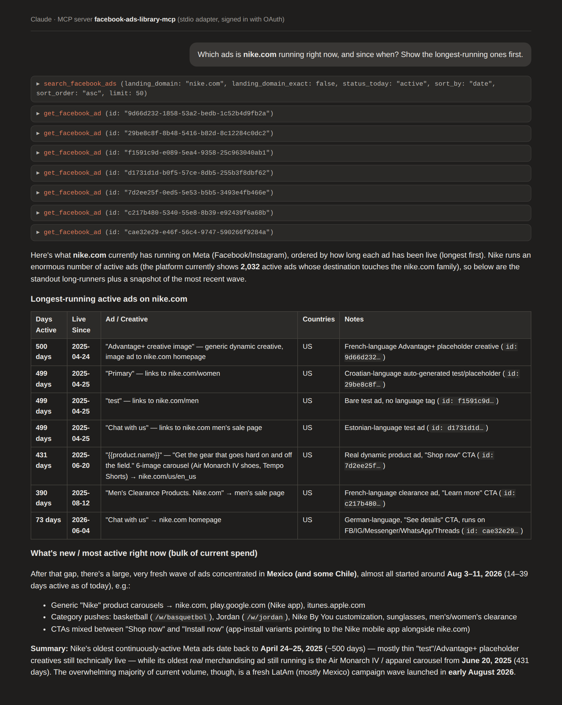

# Facebook Ads Library MCP Server

[](LICENSE)

Search the Meta / Facebook ads library from your AI assistant: find the ads a brand or a
competitor is running, see the advertisers behind them, pull the creatives and the media,
and rank what is scaling — in one conversation, without opening a dashboard.

This is a scenario adapter for the hosted [Spytrend MCP server](https://spytrend.com/mcp/?utm_source=github-facebook-ads-library-mcp&utm_medium=repo&utm_campaign=mcp-launch).
Spytrend adds 170M+ new Meta ads a month across placements, groups them by advertiser and
destination, and sorts them into 33 business categories. This adapter exposes the Meta part of
that corpus with Facebook-specific tool names, so an assistant never has to guess which source
it is querying.

## Example prompts

> Which ads is **nike.com** running right now, and since when? Show the longest-running ones first.

> Find Facebook ads mentioning "collagen gummies" in Germany in the last 30 days. Group them by advertiser.

> Who are the biggest advertisers in the pet-supplies category in the United States this month?

> Take this ad id and find related ads from the same page or the same landing domain.

> Download the video and the image variants for these three ad ids.



## Connect

### Option A — hosted server, nothing to install (recommended)

**Endpoint**

```text
https://mcp.spytrend.com/mcp
```

**Sign-in:** your Spytrend account, in the browser. No API key, no token to paste. Works on
every plan, including the free one.

1. Open your client's connector settings.
2. Add a remote MCP server and give it the URL above.
3. Sign in when the browser window opens, and start asking.

Per-client walkthroughs (Claude, ChatGPT, Cursor, Codex, VS Code):
[Spytrend/spytrend-mcp → docs/quickstart.md](https://github.com/Spytrend/spytrend-mcp/blob/main/docs/quickstart.md).

### Option B — this adapter (Facebook-only tool names)

Requires Node 20+ (20.18.1 or newer). The adapter runs locally over stdio and forwards its tool calls to the hosted
server above; the first call opens the same Spytrend sign-in in your browser. The sign-in token is kept on your
machine by [mcp-remote](https://github.com/geelen/mcp-remote) in `~/.mcp-auth` (set
`MCP_REMOTE_CONFIG_DIR` to move it); delete that folder to sign out. Nothing goes into this
repository or your client config.

Claude Desktop, Cursor, or any stdio client:

```json
{
  "mcpServers": {
    "facebook-ads-library": {
      "command": "npx",
      "args": ["-y", "github:Spytrend/facebook-ads-library-mcp"]
    }
  }
}
```

Claude Code:

```bash
claude mcp add facebook-ads-library -- npx -y github:Spytrend/facebook-ads-library-mcp
```

## Tools (8)

| Tool | What it does |
|---|---|
| `search_facebook_ads` | Search Meta ads by text, country, category, advertiser or landing domain |
| `get_facebook_ad` | Open one ad: copy, destination, run dates, creative |
| `search_facebook_advertisers` | Find advertiser pages by name or filters |
| `get_facebook_advertiser` | One advertiser page: volume, countries, active ads |
| `get_facebook_ads_analytics` | Aggregates over a filtered ad selection (Pro plan or higher) |
| `find_similar_facebook_ads` | Ads related by page or landing domain |
| `get_facebook_ad_media` | Download images and videos for ad ids |
| `get_usage` | Your plan and remaining quota (free) |

Every tool maps to one tool of the hosted server, with the source pinned to Meta. Pricing is
the server's: every delivered row costs one Spytrend token; opening an ad with media costs one
token (fifty for multi-language uploads). Details:
[spytrend.com/mcp](https://spytrend.com/mcp/?utm_source=github-facebook-ads-library-mcp&utm_medium=repo&utm_campaign=mcp-launch).

## What this is and is not

- It queries Spytrend's own database. It does not scrape Facebook, does not ship Meta code and
  does not bypass any platform access control.
- Meta, Facebook and Instagram are trademarks of Meta Platforms, Inc. This project is not
  affiliated with, endorsed by or sponsored by Meta Platforms, Inc.
- For the full server with all 22 tools, six ready-made research workflows and TikTok coverage,
  see the canonical repository: [Spytrend/spytrend-mcp](https://github.com/Spytrend/spytrend-mcp).

## Support

Questions about connecting, access or your account: [spytrend.com/contact](https://spytrend.com/contact/?utm_source=github-facebook-ads-library-mcp&utm_medium=repo&utm_campaign=mcp-launch).
Something wrong in this repository: open an issue. Security reports go through the route
described in the canonical repository's [SECURITY.md](https://github.com/Spytrend/spytrend-mcp/blob/main/SECURITY.md),
never through issues.

## License

MIT — see [LICENSE](LICENSE). The licence covers this adapter and its documentation. The
server itself is part of the Spytrend platform.
